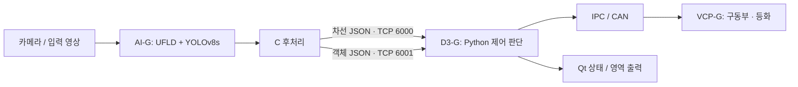

# Telechips NPU ADAS

**UFLD 차선 인식과 YOLOv8s 객체 탐지 결과를 C 후처리·TCP 통신·차량 제어 입력으로 연결한 교육 프로젝트입니다.**

윤종범 · 국민대학교 자동차IT융합학과
`C` · `Python` · `NPU` · `Linux / WSL` · `TCP / JSON` · `IPC / CAN` · `FreeRTOS`

## 프로젝트에서 다룬 문제

학습한 인식 모델을 보드에 올리는 과정에서는 모델 변환뿐 아니라 출력 텐서 해석, 좌표 복원, 보드 간 통신, 제어 입력의 형식까지 맞춰야 했습니다. 텔레칩스 교육 환경의 AI-G·D3-G·VCP-G를 사용하면서 이 연결 과정을 구현하고 실습했습니다.

| 작업 | 공개 코드에서 확인할 수 있는 내용 |
|---|---|
| UFLD C 후처리 | 출력 텐서의 row 순서 변환, softmax·차선 위치 계산, no-lane 처리 |
| 차선 결과 전송 | INT8 출력의 grid argmax, 1280×720 좌표 복원, 조향 참고값 산출, TCP JSON 전송 |
| YOLO 결과 연동 | 탐지 결과를 class·score·bounding box JSON으로 직렬화하고 별도 포트로 전송 |
| 인지 → 제어 연결 | 차선 조향과 객체 위치를 합쳐 조향·감속·정지·등화 제어값 계산 |
| 보드 디버깅 | UFLD 로그 좌표를 Linux framebuffer에 그리는 시각화 도구 |
| 임베디드 기초 | VCP GPIO LED, I2C LCD, PDM LED·서보 실습 및 BSP 연동 변경분 |

## 시스템 흐름



이 저장소는 모델을 새로 제안한 연구가 아니라, **기존 인식 모델의 NPU 적용과 시스템 통합 작업**을 보여줍니다. 교육용 골격과 공급업체 SDK를 바탕으로 한 부분은 [출처와 공개 범위](THIRD_PARTY.md)에 적었습니다.

## 코드 둘러보기

- [`npu/ufld/custom_postproc.c`](npu/ufld/custom_postproc.c): softmax 기반 차선 후처리 실습.
- [`npu/ufld/post_process.c`](npu/ufld/post_process.c): argmax 기반 차선 결과·조향값을 D3-G로 보내는 통합 경로.
- [`npu/yolo/result_sender.c`](npu/yolo/result_sender.c): YOLO 결과 TCP 송신부. SDK가 생성하는 detector 본체와 분리했습니다.
- [`control/Data_parsing_student.py`](control/Data_parsing_student.py): JSON 수신·병합, 제어 판단, IPC/CAN·Qt 출력. `학생 구현 영역`에 제어 판단 로직이 있습니다.
- [`tools/ufld_log_viewer.c`](tools/ufld_log_viewer.c): `Point[row][lane]` 로그를 읽는 framebuffer 시각화.
- [`examples/lenet/train_lenet.py`](examples/lenet/train_lenet.py): 3채널 입력 LeNet의 MNIST 학습·ONNX export 실습.
- [`vcp/`](vcp/README.md): 주변장치 실습 소스와 원본 BSP 대비 변경분.

## 보드 없이 확인하기

Python 3.9 이상, GCC, Make가 있는 Linux / WSL에서 실행할 수 있습니다. 아래 예제는 소켓이나 차량 장치를 열지 않습니다.

```bash
python3 tools/replay_control.py --scenario lane-following
python3 tools/replay_control.py --scenario center-close
make check
```

`center-close`는 중앙의 큰 객체를 입력으로 넣어 `speed_kmh: 0.0`, `brake_light: true` 판단을 출력합니다. 입력은 재현용 합성 JSON이며 실제 주행 성능을 측정한 데이터가 아닙니다.

## 보드 환경과 검증 범위

NPU 플러그인의 빌드에는 별도로 설치한 ENLIGHT SDK, 모델 변환 결과, 해당 보드의 런타임이 필요합니다. [빌드·통합 방법](docs/BUILD_AND_RUN.md)과 [메시지 형식](docs/PROTOCOL.md)을 함께 참고하세요. SDK·가중치·데이터셋·교육 PDF·빌드 바이너리는 포함하지 않았습니다.

공개용으로 정리하며 **Python 제어·스트림 처리 테스트, C 소스 컴파일, 셸 구문 검사**를 수행했습니다. 이번 공개 과정에서 실제 보드·카메라·CAN 장치를 다시 연결해 검증하지는 않았습니다. FPS·검출 정확도·정지거리 수치는 제시하지 않습니다. 두 UFLD 경로는 서로 다른 실습 단계이며 동등한 알고리즘으로 간주하면 안 됩니다. 조향·판단 로직의 제약은 [검증 기록](docs/VALIDATION.md)에 정리했습니다.
